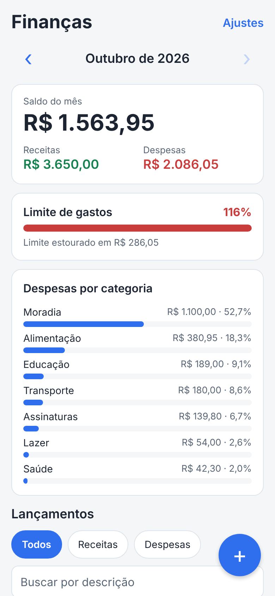
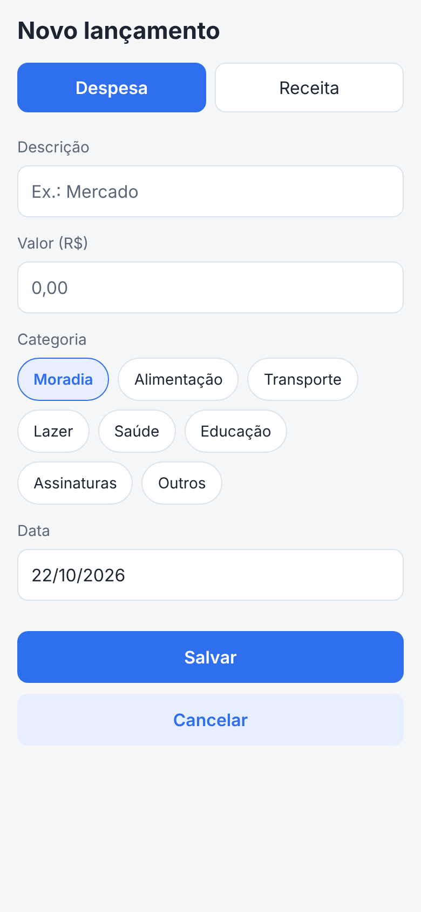

# Finance (React Native)

🇧🇷 [Português](README.pt-BR.md) · 🇺🇸 English

A personal finance app for mobile, built with React Native and Expo. It records income and expenses and shows each month's balance, spending by category and how much of the monthly limit has been used. Data is saved on the device, with no internet and no account.

It is the mobile version of [financas-pessoais-js](https://github.com/vitorbg7/financas-pessoais-js): the business rules came from there, now in TypeScript.

| Month summary | New entry |
| --- | --- |
|  |  |

## Features

- Register income and expenses, with category, date and amount
- Month navigation, with balance, income and expenses
- Expenses by category, with amount and percentage
- Monthly spending limit with a progress bar (changes color near the limit)
- Filter by type and search by description, ignoring accents and case
- Delete with confirmation
- Export the month as CSV (shared as text)
- Sample data for quick testing

## Technologies

React Native 0.88 · Expo SDK 58 · TypeScript · AsyncStorage · Jest and Testing Library

## Structure

```
App.tsx                 Main screen: wires components together and computes what to show
src/
  dominio/              Business rules as pure functions, no React
    dinheiro.ts           Text to cents conversion and formatting in reais
    datas.ts              Dates and months
    transacoes.ts         Creation, validation, filters and sorting
    relatorios.ts         Summary, spending by category, limit and CSV
    exemplo.ts            Sample data
  armazenamento.ts      Reads and writes AsyncStorage, with validation
  useFinancas.ts        Hook with the app state and actions (add, remove, limit)
  componentes/          Screens and interface pieces
  __tests__/            Logic and screen tests
```

The screens do not know the storage and the `dominio` folder does not know React. That is why the logic is tested without rendering anything.

## Decisions

- **Money as integer cents.** Avoids floating-point errors like `0.1 + 0.2`. Typed text goes through a validator that accepts `1.234,56`, `12,5` or `R$ 10` and rejects `1,005` (half a cent).
- **Dates as `YYYY-MM-DD` text.** No `Date` object and no time zone, so the 23rd never becomes the 22nd. The form uses `DD/MM/YYYY` and converts.
- **Nothing derived is stored.** Balance, totals by category and limit progress are computed from the list of entries, so they never differ from the data.
- **Stored data is validated on read.** If an item is corrupted, only that item is discarded and the app opens normally.
- **Hand-written formatting** (`formatarMoeda`, month names) instead of `Intl`, so the result does not depend on each device's support.
- **No navigation library.** The app has one main screen and two modals, so simple state is enough.

## Running

Requires [Node.js](https://nodejs.org) (LTS version) and the **Expo Go** app on your phone.

```
npm install
npx expo start
```

Scan the QR code shown in the terminal with Expo Go (Android) or the camera (iPhone). The phone and the computer must be on the same Wi-Fi network.

## Tests

```
npm test
npm run typecheck
```

Tests cover the business rules (amount conversion, dates, validation, filters, reports, CSV) and the screen flow: adding, validating the form, filtering, deleting and reloading saved data.
